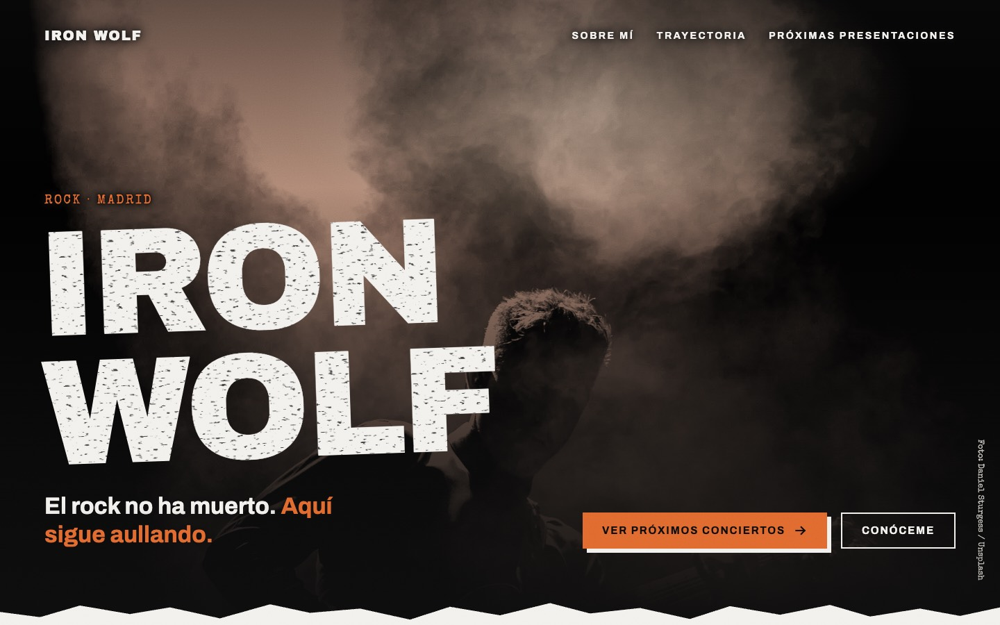

# Iron Wolf — Landing de un artista de rock

Landing page de **Iron Wolf**, un cantante y guitarrista de rock de Vallecas (Madrid). Es el
ejercicio de 4Geeks Academy *"Muestra el talento de tu amigo artista con un website"*, hecho
**solo con HTML y CSS**, sin JavaScript, con atención especial a la semántica, la accesibilidad y
el SEO.

> **Iron Wolf es un artista ficticio.** Las salas de la gira son reales; las fechas, el Meseta
> Rock Festival y la banda The Black Highway son inventados. Las personas de las fotos no son él.



## Qué tiene la web

Una sola página con cinco secciones, cada una de al menos una pantalla de alto:

| Sección | Contenido |
|---|---|
| Portada | Nombre, lema y dos botones sobre una foto en blanco y negro con un foco de luz |
| 01 Sobre mí | Su historia en primera persona, una foto pegada con cinta y tres datos rápidos |
| 02 Galería | Dos fotos en directo con efecto de interferencia |
| 03 Trayectoria | Línea del tiempo de 2015 a 2026 y discografía |
| 04 Próximas presentaciones | Gira 2027 en forma de entradas de concierto |

El menú lleva a Sobre mí, Trayectoria y Próximas presentaciones. En móvil es un menú hamburguesa a
pantalla completa, y la cabecera y el botón de volver arriba acompañan al hacer scroll. Todo
funciona sin JavaScript.

## Cómo verla en local

No hay dependencias ni nada que compilar. Desde la raíz del proyecto:

```bash
python3 -m http.server 8080 --bind 127.0.0.1
```

Abre http://127.0.0.1:8080. Para parar el servidor, pulsa `Ctrl + C`.

Para verla en un móvil de la misma red wifi, arranca el servidor con `--bind 0.0.0.0` y abre en el
móvil `http://<IP del ordenador>:8080`.

## Estructura

```text
├── index.html            ← la página
├── styles.css            ← todos los estilos, en 9 bloques comentados
├── assets/
│   ├── images/           ← fotos en WebP, og.jpg, originales y CREDITS.md
│   ├── textures/         ← grano y tinta gastada (SVG)
│   └── favicon.svg
├── BRIEFING.md           ← quién es el artista y qué pide
├── CONTENT.md            ← todos los textos de la web
├── DESIGN.md             ← sistema visual: colores, tipografía, componentes, animaciones
├── PLAN.md, plans/       ← plan de trabajo por fases
├── verification.md       ← verificación final de los criterios
├── design/               ← maqueta aprobada y capturas de cada fase
├── AGENTS.md, .agents/, memory-bank/   ← instrucciones y contexto para agentes de IA
└── server.py, learn.json ← plantilla de 4Geeks
```

## Decisiones de accesibilidad

- **HTML semántico:** `header`, `nav`, `main`, `section` con `aria-labelledby`, `footer`, listas,
  `figure`, `time`, `dl`, `cite` y `address`. Un solo `h1` y ningún salto en los títulos.
- **Lector de pantalla:**
  - Los textos alternativos salen de `CONTENT.md`.
  - Todo lo decorativo va oculto con `aria-hidden`.
  - Los botones de entradas dicen la ciudad, la sala y la fecha, no solo "Entradas".
  - Con el menú abierto, la página de detrás se oculta.
- **Teclado:**
  - El enlace "Saltar al contenido" va al principio.
  - El foco siempre es visible, un contorno naranja de 3px.
  - Ningún elemento con foco queda bajo la cabecera fija ni detrás del botón ↑.
- **Contraste** de 4,5:1 o más en todo el texto.
- **Botones y enlaces** de 44px o más, fáciles de tocar en móvil.
- **Movimiento:** con "Reducir movimiento" activado en el sistema, nada se mueve. Si el navegador
  no admite las animaciones de scroll, todo se ve quieto y completo.

## Decisiones de SEO

- `<title>`, `meta description` y Open Graph con textos propios.
- Datos estructurados de **Schema.org** en JSON-LD:
  - El artista (`MusicGroup`), su EP y sus tres singles.
  - Los 4 conciertos de la gira (`MusicEvent`), con la dirección de cada sala comprobada en su web
    oficial.
  - El validador de schema.org da 0 errores, y la prueba de resultados enriquecidos de Google
    detecta los 4 eventos.
- Imágenes en WebP con `width` y `height`, y la portada con `fetchpriority="high"`.

La web no está publicada, así que no lleva `canonical` ni `og:url`. Los detalles están en
[`verification.md`](verification.md).

## Créditos

Fotos de [Unsplash](https://unsplash.com), con su licencia:

- **Daniel Sturgess:** portada.
- **Hector Bermudez:** Sobre mí.
- **Diane Picchiottino:** Galería, foto 1.
- **Greyson Joralemon:** Galería, foto 2.

Están detalladas en [`assets/images/CREDITS.md`](assets/images/CREDITS.md). Las texturas son
propias, generadas con filtros SVG. Las fuentes (Archivo Black, Archivo y Special Elite) son de
Google Fonts.
